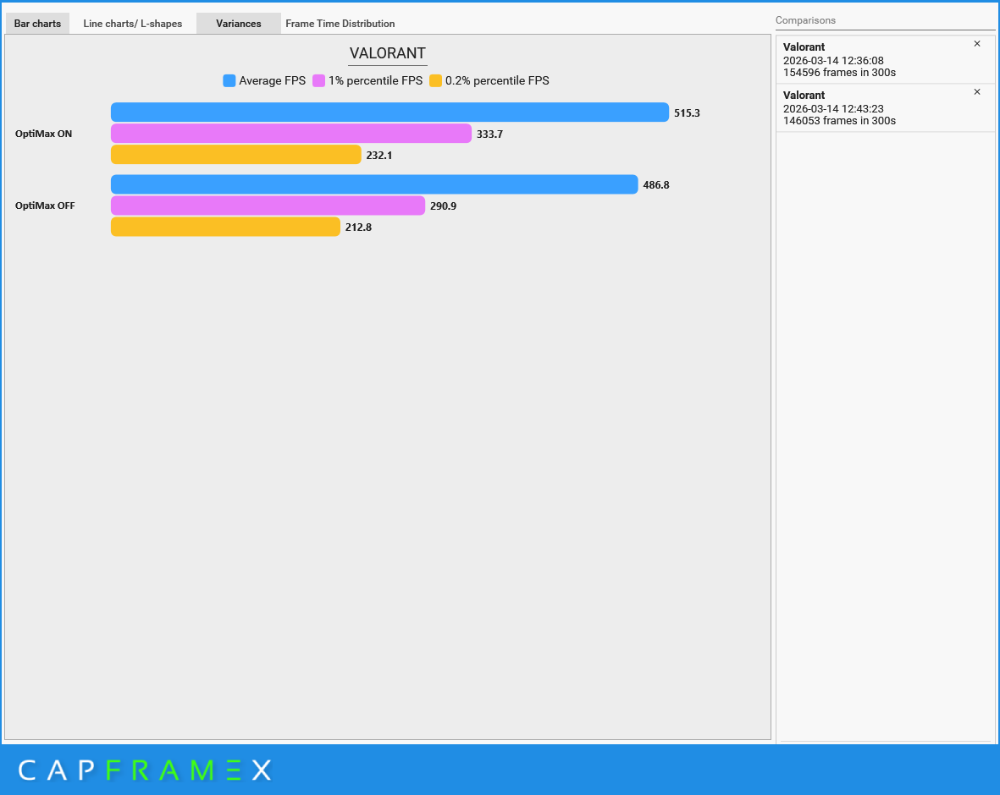

# OptiMax Pro-Tuner

[](https://github.com/BigBE4TS/OptiMax-Pro-Tuner/releases/latest)
[](https://www.virustotal.com/gui/file/5e02adb9f5d76e587137995bbe2d153bf05214c686ee8047f9008bf317396a7a)
[](https://www.microsoft.com/en-us/wdsi/submissions)
[](https://optimax-pro-tuner.pages.dev)

**Steadier frame times. Measured, not promised.**

OptiMax watches frame times, DPC latency and what your PC is doing while you play, tells you what
is actually limiting you, then tunes the Windows timer, priorities and interrupts. Every change has
an undo. It is a native C++17 and DirectX 11 app: one ~2 MB exe, no installer, no Electron, no
browser engine.

**[Download the latest release](https://github.com/BigBE4TS/OptiMax-Pro-Tuner/releases/latest/download/OptiMax_Profiler.exe)** ·
[Release notes](https://github.com/BigBE4TS/OptiMax-Pro-Tuner/releases/latest) ·
[Website](https://optimax-pro-tuner.pages.dev)

Free · Windows 10 & 11 (including LTSC) · NVIDIA & AMD · x64

---

## Benchmarks

Most optimizers quote one flattering number. These are the measurements, including the ones that
show a small effect.

### Valorant: CapFrameX, 0.1% lows



A 5-minute CapFrameX capture of *Valorant* (Ryzen 7 5800X3D / RTX 4070 Ti), Core Tweaks on versus
stock Windows 11:

- **0.1% lows +15.0 FPS (+9.7%)**: the floor during heavy fights is higher.
- **1% lows +7.9 FPS (+3.6%)**.
- **Frame-time variance (adaptive STDEV) 8.9% tighter.**
- The highest frame rates (P99) came down slightly. Steadier, not faster at the peak.

### Forza Horizon 6: background throttling, about 1 FPS

Built-in benchmark at Very Low, 1080p, so the CPU is the limit (GPU-limited 0.0% on every run).
Ryzen 7 5800X3D, RTX 4070 Ti, with 16 background processes each maxing a CPU thread. Runs
alternated off/on.

| Run | Setup | Avg FPS | 1% low |
|---:|---|---:|---:|
| 1 | Throttling off | 188 | 144.1 |
| 2 | Throttling on | 188 | 146.3 |
| 3 | Throttling off | 186 | 139.3 |
| 4 | Throttling on | 189 | 145.5 |
| 5 | No background load | 194 | 134.5 |

Forza already asks Windows to serve it first, so the background load only cost it about 4%, which
leaves little to win back. 1% lows were about 3% better with throttling on, which is right at
run-to-run noise. We are not going to call that a boost.

### A normal-priority "game": 25 → 477 FPS

OptiMax's own stress bench: a frame loop at normal priority against one CPU hog per thread
(5800X3D, 16 threads). This is the case throttling exists for, games that don't prioritise
themselves.

| Setup | Avg FPS | 99th percentile frame time |
|---|---:|---:|
| No background load | 468 | 2.6 ms |
| Hog per core, throttling off | 25 | 108 ms |
| Hog per core, throttling on | 477 | 2.5 ms |

On an idle PC there is nothing to win back, and OptiMax will tell you so rather than claim a gain.

**How to test any optimizer:** throw away the first run (warm-up alone was worth +40% average FPS
in our testing), use the game's built-in benchmark, alternate off/on/off/on, take at least three
runs per side, and compare 1% lows rather than averages.

---

## What it does

- **Diagnostics.** Live CPU, GPU, memory, video memory and DPC latency, a stall watchdog, and
  frame-time capture. When something hitches, OptiMax says what held your machine up, including
  when the cause was another program or OptiMax itself, and when it cannot help.
- **Core Tweaks.** Windows timer resolution, core parking off, CPU and GPU priorities, and GPU
  interrupt placement, applied while your game runs and taken back off when it closes.
- **Game library.** Per-game settings, optional P-core pinning, and per-game NVIDIA low-latency
  mode.
- **Background throttling and Contention Guard.** Background apps are held back while you play. With
  Contention Guard on (it is off by default), if a measured stall comes from one program hogging the
  CPU, that program is lowered one step for a minute, then put back.
- **Tweaks.** GPU MSI mode, the TCP/network latency tweak, MMCSS game profile, Game DVR off, mouse
  1:1, and more. Each one says what it changes.
- **Every change has an undo.** OptiMax records what you had before it changes something and puts
  that back. **Turn Off All Tweaks** undoes what it applied; **Restore Windows Defaults** goes
  further. Some changes (VBS, MSI mode, interrupt placement, boot timer) need a restart, and the app
  tells you when.
- **Six skins.** Unslop (the default), Classic, Ultraviolet, Solar Flare, Neon Pulse and Acid Lime.
  [See them](https://optimax-pro-tuner.pages.dev).

## Install and run

1. Download `OptiMax_Profiler.exe` from the
   **[latest release](https://github.com/BigBE4TS/OptiMax-Pro-Tuner/releases/latest)**.
2. Run it. It asks for administrator rights itself, because it changes system settings.
3. Add your game in **Games**, turn on **Core Tweaks**, and play. OptiMax spots the game starting
   and applies its settings, then removes them when the game closes.

**Start with Windows** (in Settings) runs OptiMax from a protected copy in
`C:\Program Files\OptiMax Pro\`, which programs without admin rights cannot change.

**Updates install themselves, and they are signed.** Every update must carry a signature from the
OptiMax release key (ECDSA P-256), which is held offline and never on GitHub. An update that is
unsigned, signed by anyone else, or older than what you run is refused, even if it comes from this
page.

---

## Antivirus and safety

OptiMax changes system settings, asks for administrator rights, and is not code-signed
(Authenticode). Machine-learning scanners sometimes flag that combination, and Windows SmartScreen
may warn the first time you run a downloaded copy.

**v4.6.0 status:**

| Check | Result |
|---|---|
| [VirusTotal](https://www.virustotal.com/gui/file/5e02adb9f5d76e587137995bbe2d153bf05214c686ee8047f9008bf317396a7a) | 1/72. The only one is Symantec `ML.Attribute.HighConfidence`, a generic machine-learning heuristic, not a malware family |
| Microsoft Defender | Not detected |
| Microsoft security-intelligence review | "No positive detection, no telemetry indicators". Submission `aa8f418b-4513-4480-9f0e-560f688cb9fd`, closed |

**Check your download:**

```powershell
Get-FileHash .\OptiMax_Profiler.exe -Algorithm SHA256
```

It should match the first line of [`OptiMax_Profiler.exe.sha256`](OptiMax_Profiler.exe.sha256). For
v4.6.0 that is `5e02adb9f5d76e587137995bbe2d153bf05214c686ee8047f9008bf317396a7a`.

---

## Source code

The source (C++17, Win32 + Dear ImGui + DirectX 11) is kept in a private repository. This
repository holds the releases, the update files and the community game profiles (`profiles.db`).

## Licence

Source-available; see [`LICENSE`](LICENSE). Redistribution, derivative works and commercial use
require written permission.

Binaries released before the licence change went out under the MIT Licence, and that grant still
applies to those versions.
